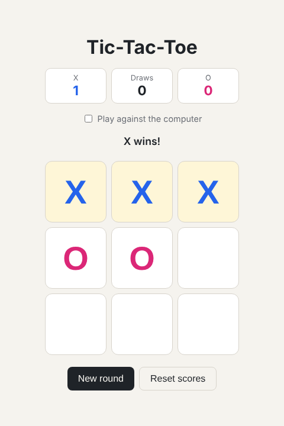

# Tic-Tac-Toe

A classic Tic-Tac-Toe game that runs in the browser, built with plain HTML, CSS and JavaScript.

**Play it live:** https://uzoma-max.github.io/Tic-Tac-Toe/



## Features

- Two players on the same device, or play against the computer
- The computer uses the minimax algorithm, so it never loses
- Highlights the winning line and detects draws
- Keeps score across rounds
- Works on phones and supports dark mode

## How to run it

No installation needed. Download or clone the repo and open `index.html` in your browser:

```bash
git clone https://github.com/uzoma-max/Tic-Tac-Toe.git
cd Tic-Tac-Toe
open index.html   # on Windows: start index.html
```

## How it works

- `index.html` sets up the scoreboard and the 3x3 board.
- `style.css` handles the layout, colours and dark mode.
- `script.js` tracks the board, checks the eight possible winning lines after each move, and runs minimax for the computer's moves.

## What I learned

- Handling click events and updating the page with JavaScript
- Representing game state as an array and checking for wins
- Writing a simple game AI with recursion (minimax)
